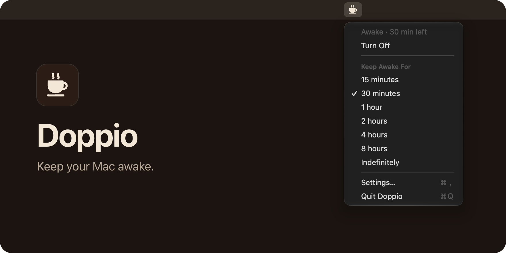
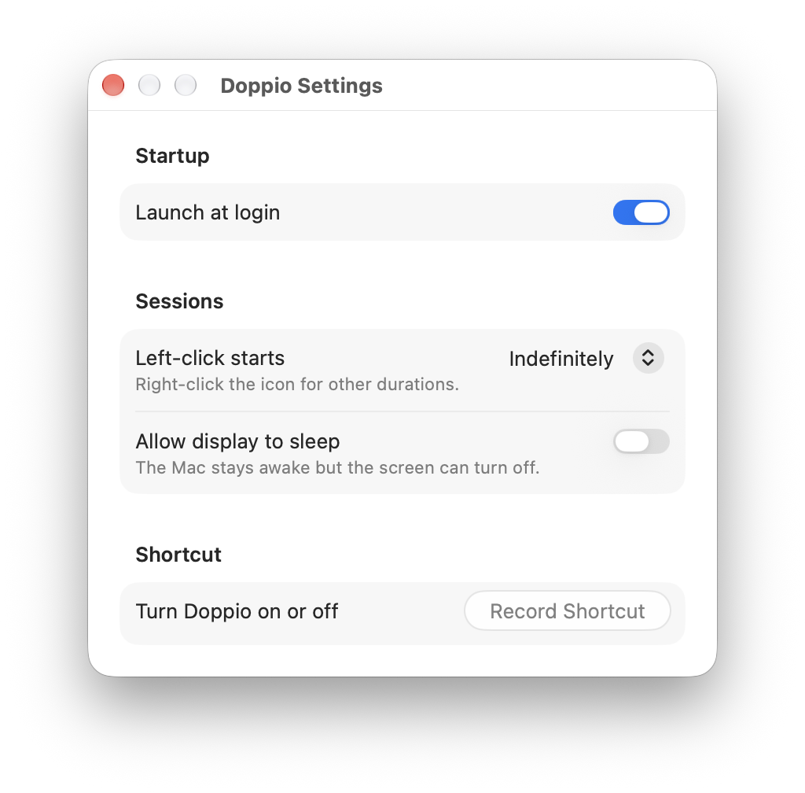

<p align="center">
  
</p>

# Doppio

[](https://github.com/lantelyes/doppio/releases/latest)
[](https://github.com/lantelyes/doppio/actions/workflows/ci.yml)
[](LICENSE)


Doppio is a small menu bar app that keeps your Mac from falling asleep. Click the cup to turn it on, click it again to turn it off, or right-click to set a timer.

**[Download Doppio 1.0.0](https://github.com/lantelyes/doppio/releases/download/v1.0.0/Doppio-1.0.0.zip)** · [Website](https://lantelyes.github.io/doppio/)

## What it does

- **One click.** Left-click the cup to keep your Mac awake. Click again to let it sleep.
- **Timed sessions.** Right-click for 15 minutes, 30 minutes, 1, 2, 4 or 8 hours. Doppio turns itself off when the time is up.
- **Screen on or off.** Keep the display lit, or let it sleep while the Mac keeps working.
- **Global shortcut.** Record any key combination to toggle Doppio from anywhere.
- **Launch at login**, if you want it always there.

It has no Dock icon, no account, no analytics, and makes no network connections.

## Settings

<p align="center">
  <picture>
    <source media="(prefers-color-scheme: dark)" srcset="docs/assets/settings-dark.png">
    
  </picture>
</p>

## Install

1. Download [Doppio-1.0.0.zip](https://github.com/lantelyes/doppio/releases/download/v1.0.0/Doppio-1.0.0.zip) and unzip it.
2. Drag **Doppio** into your Applications folder and open it.
3. macOS will block the first launch, because Doppio isn't notarized by Apple. Open **System Settings → Privacy & Security**, scroll down, and click **Open Anyway**. You only need to do this once.

Doppio needs macOS 14 or later and runs on Apple Silicon and Intel. It is developed and tested on macOS 27; earlier versions should work but haven't been tested.

## Use

| Action | Result |
| --- | --- |
| Left-click the cup | Turn Doppio on or off. What "on" starts is set by **Left-click starts** in Settings (indefinitely by default). |
| Right-click the cup | Open the menu: time remaining, timed sessions, Settings, Quit. |
| Your shortcut | Same as a left-click, from any app. Record it in Settings. |

The cup is an outline when Doppio is off, and filled with steam when it is on.

Doppio prevents *idle* sleep. Closing the lid, choosing Sleep from the Apple menu, or a scheduled sleep will still put your Mac to sleep.

## How it works

Doppio holds an IOKit power assertion while a session is active, the same mechanism as the built-in `caffeinate` command. A session survives a manual sleep and wake; timed sessions follow the real clock, so one that ran out while the Mac was asleep is off when it wakes. Quitting Doppio always ends the session.

## Build from source

You need Xcode and [XcodeGen](https://github.com/yonaskolb/XcodeGen).

```sh
brew install xcodegen
git clone https://github.com/lantelyes/doppio.git
cd doppio
xcodegen generate
open Doppio.xcodeproj
```

Run the tests with:

```sh
xcodebuild -project Doppio.xcodeproj -scheme Doppio -derivedDataPath build test
```

`Scripts/release.sh` builds the universal, ad-hoc signed app and zips it into `dist/`.

## Licence

MIT. See [LICENSE](LICENSE).

Doppio uses [KeyboardShortcuts](https://github.com/sindresorhus/KeyboardShortcuts) by Sindre Sorhus, also MIT.
